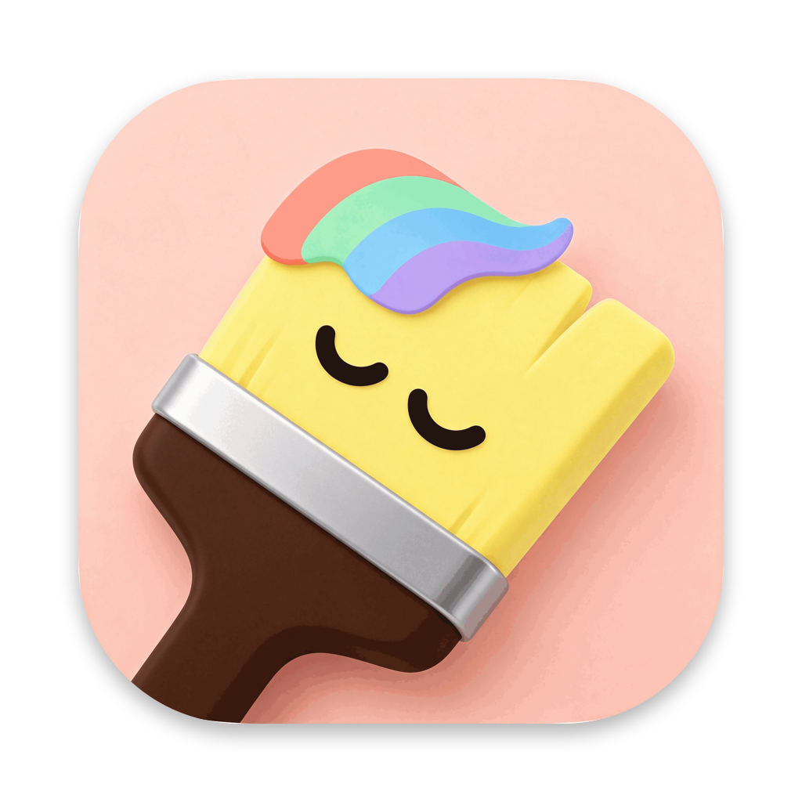
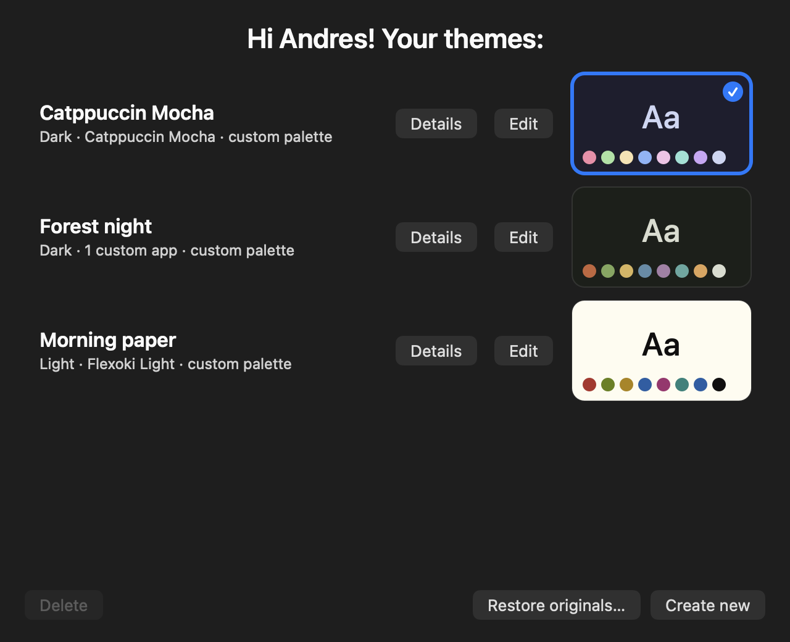
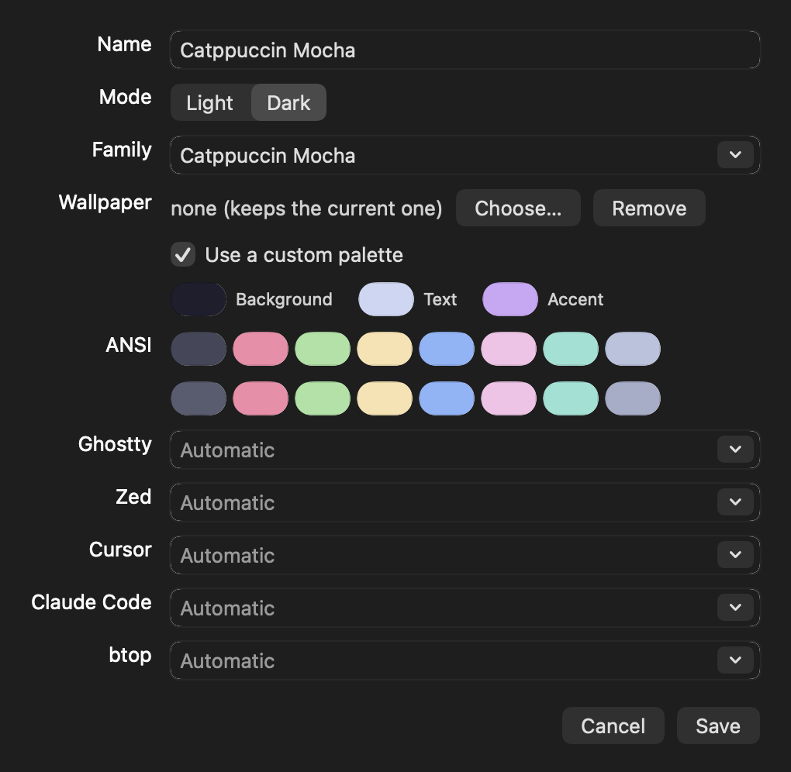

<div align="center">



# Choosy

**One click, and your whole Mac changes its look.**<br>
Light or dark mode, wallpaper and the theme of your dev tools (Ghostty, Zed, Cursor, VS Code, Claude Code, btop, starship), switched together.

[](https://github.com/Andss-ye/choosy-releases/releases/latest/download/Choosy.dmg)

[](https://github.com/Andss-ye/choosy-releases/releases/latest)
[](https://github.com/Andss-ye/choosy-releases/releases)


[](LICENSE)



</div>

> [!NOTE]
> The first public release is on its way. Watch this repo (**Watch → Custom → Releases**) to know when it lands.

## What it does

You probably have a terminal theme, an editor theme, a wallpaper and a system mode that only match on a good day. Choosy keeps them in a **theme** and switches all of them at once, from the menu bar, from its window or from the terminal.

- **Finds what you use.** Choosy looks at what is installed and only touches those apps.
- **Uses the themes your apps already have.** Say "Catppuccin Mocha" and each app gets its own Catppuccin Mocha. If an app doesn't have it, bring your own 16-color palette and Choosy generates the theme for Ghostty, Zed, btop and starship.
- **Tiny and fast.** Native Swift and AppKit, a ~430 KB binary, about 8 MB of memory and no background work. A theme switch takes a couple of milliseconds; a theme file is under 1 KB.
- **Careful with your config.** It changes only the theme line or key, keeps your comments and symlinks, makes a backup first, and **Restore originals** puts every value back without touching your own edits.

## Supported apps

| App | What changes |
|---|---|
| macOS | Light or dark mode |
| Wallpaper | Any image, including dynamic `.heic` |
| [Ghostty](https://ghostty.org) | The light or dark slot of `theme`, or a generated theme |
| [Zed](https://zed.dev) | The light or dark slot of `"theme"`, or a generated theme |
| [Cursor](https://cursor.com) and [VS Code](https://code.visualstudio.com) | `workbench.preferredLight/DarkColorTheme` |
| [Claude Code](https://claude.com/claude-code) | `theme`, or the ANSI variant that follows your terminal colors |
| [btop](https://github.com/aristocratos/btop) | `color_theme`, reloaded live |
| [starship](https://starship.rs) | A `choosy` palette for its named colors |

Missing your tool? [Ask for it](https://github.com/Andss-ye/choosy-releases/issues/new?template=feature.yml).

## Install

Paste this in Terminal:

```sh
curl -fsSL https://raw.githubusercontent.com/Andss-ye/choosy-releases/main/install.sh | sh
```

It downloads the latest `Choosy.dmg`, copies Choosy to **Applications** and opens it. Because `curl` does not mark the download as coming from a browser, macOS shows no warning. Read [`install.sh`](install.sh) first if you like: it is short.

Prefer the DMG?

1. [Download `Choosy.dmg`](https://github.com/Andss-ye/choosy-releases/releases/latest/download/Choosy.dmg), open it and drag **Choosy** to **Applications**.
2. Open Choosy. macOS blocks it the first time because the app is not notarized (see the [FAQ](#faq)). Click **Done**, then go to **System Settings → Privacy & Security**, scroll to the Choosy message and click **Open Anyway**.

Requires macOS 26 or later on a Mac with Apple Silicon (M1 or newer).

## Use it

The first time you open Choosy it saves your current setup as **Theme personalized 1** (and **2** for the other mode), so nothing changes until you pick something.



- **Window:** click a preview to apply that theme. **Details** shows what each app will get, **Edit** opens the editor and **Create new** starts from the gallery (Catppuccin, Flexoki, Melange, Gruvbox, Rosé Pine, Tokyo Night), a family name or a blank palette.
- **Menu bar:** your themes, one click away.
- **Terminal:** `choosy list`, `choosy apply <theme>`, `choosy preview <theme>`, `choosy restore`. The installer prints how to add the `choosy` command.

Ghostty doesn't reload its config by itself: press <kbd>⌘</kbd><kbd>⇧</kbd><kbd>,</kbd> after switching. Claude Code picks up the new theme in its next session.

<br clear="right">

### Themes are files

Each theme lives in `~/.config/choosy/themes/<id>.json`:

```json
{
  "name": "Night shift",
  "mode": "dark",
  "family": "Catppuccin Mocha",
  "wallpaper": "~/Pictures/night.heic",
  "apps": { "btop": "tokyo-night" }
}
```

`choosy schema` prints the full format and `choosy validate` checks a file. AI coding agents can write them for you: point Claude Code or Cursor at the schema, and Choosy does the switching.

## Updates

Choosy updates itself with [Sparkle](https://sparkle-project.org). It checks once a day and on demand from **Check for Updates…** in the menu bar. Every update is verified with an EdDSA signature before it is installed.

## Privacy

Everything happens on your Mac. Choosy reads and writes only the config files of the apps listed above and its own folder, `~/.config/choosy`. The only network request is the update check, which downloads this repo's `appcast.xml` and sends nothing about you.

## FAQ

**Why does macOS warn me when I install from the DMG?**
Choosy is not notarized by Apple yet, which requires a paid developer account. It is signed with its own certificate, and every update is verified with a separate signature. The install command above avoids the warning, and updates never show it. If you would rather wait for the notarized version, that's a fair call.

**Will it mess up my dotfiles?**
It edits only the theme setting of each app, writes atomically, follows symlinks into your dotfiles repo and keeps a full backup of every file the first time it touches it. **Restore originals** (or `choosy restore`) puts each value back and keeps anything you edited yourself in the meantime.

**Why does it ask for Automation permission?**
Only if the direct way to switch light and dark mode isn't available, Choosy falls back to System Events, and macOS asks once.

**Does it work on Intel Macs?**
No, Choosy is built for Apple Silicon only.

**How do I uninstall it?**
Run **Restore originals** if you want your old settings back, quit Choosy from the menu bar and drag it from Applications to the Trash. Your themes stay in `~/.config/choosy`; delete that folder too if you don't need them.

## Feedback

Found a bug or have an idea? [Open an issue](https://github.com/Andss-ye/choosy-releases/issues/new/choose).

## Made by Andrew

[LinkedIn](https://linkedin.com/in/andss-ye) · [Portfolio](https://andssye.vercel.app/) · [GitHub](https://github.com/Andss-ye)

Choosy is free to use. See [LICENSE](LICENSE) and [third-party notices](THIRD-PARTY-NOTICES.md).
